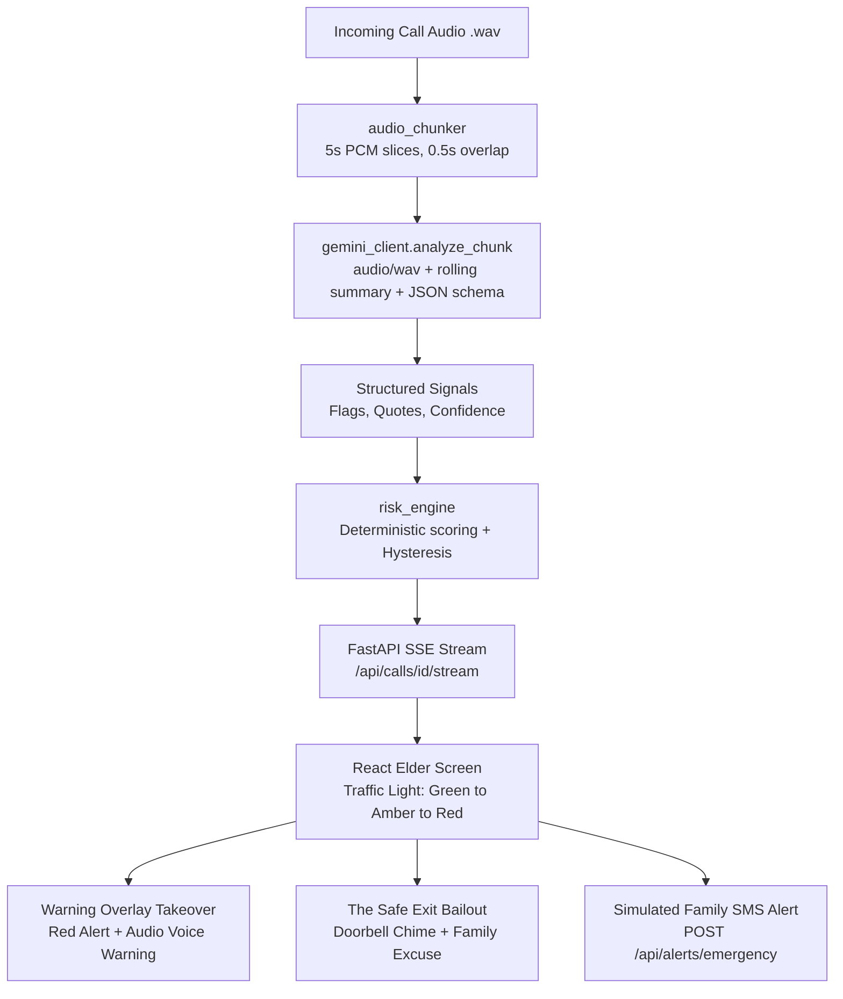

# RaasRadar — Real-time Voice AI Fraud Defense for Elders

[]()
[]()
[]()
[-success.svg)]()

> **RaasRadar** protects senior citizens from high-pressure telephone scams ("Digital Arrest", fake courier drug busts, power disconnection threats, and OTP phishing) using Gemini Flash audio understanding, a deterministic zero-false-alarm risk engine, and an accessible, high-contrast traffic-light UI with full-screen emergency takeover and **The Safe Exit Bailout** (doorbell interruption excuse). Built at **Garbathon × Google**.

---

## 1. System Architecture (Mermaid)



---

## 2. Core Decisions & Contract

| Component | Choice | Why |
|---|---|---|
| **Audio Understanding** | Gemini Flash (`google-genai` SDK) | Native colloquial Gujarati, Hindi, Hinglish, and English audio comprehension, sub-second latency, structured schema output. |
| **Streaming Engine** | 5s audio chunking with 0.5s overlap + SSE | Standard HTTP Server-Sent Events deliver low-latency real-time updates without WebSocket complexity. |
| **Risk Engine** | Pure Python Deterministic State Machine | Gemini only **detects** signals; our deterministic code decides the verdict (`SAFE` / `SUSPICIOUS` / `SCAM`). Prevents false alarms on genuine delivery calls. |
| **Warning Audio** | Pre-generated audio assets ($\le$ 60 KB each) | Static, human-reviewed, non-hallucinated localized voice warnings. |
| **The Safe Exit Bailout** | Ambient Doorbell Chime + Spoken Excuse | Solves the psychological paralysis of senior citizens by giving them a face-saving excuse (*"Someone is at the door, I must open it"*) to hang up on fake police officers without fear. |
| **Offline Replay Mode** | Precomputed JSON Cache (`samples/cache/`) | Works with **NO API key** and **NO internet connection** for guaranteed demo stability. |

---

## 3. Folder Structure

```text
scam-call-shield/
├── README.md                  # Setup, demo script, architecture diagram
├── .env.example               # GEMINI_API_KEY=, GEMINI_MODEL=, GEMINI_FALLBACK_MODEL=
├── .gitignore                 # .env, node_modules, venv, __pycache__, dist
├── Makefile                   # make dev / make test / make replay / make check-size
├── docs/
│   ├── SPEC.md                # Full technical specification
│   ├── PLAN.md                # Implementation vertical slices
│   └── DEMO_SCRIPT.md         # 2-minute narrative for judges
├── backend/
│   ├── requirements.txt
│   ├── pyproject.toml         # ruff configuration
│   ├── app/
│   │   ├── main.py            # FastAPI application with CORS
│   │   ├── config.py          # Settings and environment variables
│   │   ├── api/
│   │   │   └── routes.py      # GET /calls, GET /calls/{id}/stream (SSE), POST /alerts/emergency
│   │   ├── domain/
│   │   │   ├── schemas.py     # Pydantic schemas (DetectedFlag, ChunkAnalysis, CallState)
│   │   │   ├── red_flags.py   # FlagType enum + weights + critical flags
│   │   │   └── risk_engine.py # Scoring + SAFE/SUSPICIOUS/SCAM state machine
│   │   └── services/
│   │       ├── audio_chunker.py   # Slices WAV with 0.5s overlap using stdlib wave
│   │       ├── gemini_client.py   # analyze_chunk() with structured schema & retry
│   │       ├── prompts.py         # Gujarati/Hindi/English detection prompt
│   │       ├── replay_cache.py    # Load/save cached analyses
│   │       └── alert_stub.py      # Mocked SMS/WhatsApp emergency dispatcher
│   ├── scripts/
│   │   ├── build_cache.py         # CLI cache generator
│   │   └── generate_warning_audio.py # Warning & Doorbell audio generator
│   └── tests/
│       ├── test_risk_engine.py    # 4 scenario tests + hysteresis + confidence tests
│       ├── test_chunker.py        # 5s slicing with 0.5s overlap test
│       └── test_api_replay.py     # Chronological SSE replay integration test
├── frontend/
│   ├── package.json
│   ├── vite.config.ts
│   └── src/
│       ├── app/               # App.tsx, providers.tsx, index.css
│       ├── features/
│       │   ├── home/          # CallPicker.tsx, EmergencyContactCard.tsx
│       │   ├── call/          # CallScreen.tsx, StatusBanner.tsx, FlagChip.tsx, TranscriptPane.tsx, Waveform.tsx
│       │   ├── warning/       # WarningOverlay.tsx, AlertSentToast.tsx
│       │   └── summary/       # CallSummary.tsx
│       ├── hooks/             # useCallStream.ts, useWarningAudio.ts, useLanguage.ts
│       ├── lib/               # api.ts, types.ts, utils.ts
│       ├── i18n/              # gu.json, hi.json, en.json
│       └── assets/warning-audio/ # {flag}_{lang}.wav + safe_exit_doorbell.wav
└── samples/
    ├── manifest.json          # Call metadata and expected verdicts
    ├── calls/                 # 16kHz mono WAV audio samples
    └── cache/                 # Precomputed chunk analysis JSON
```

---

## 4. Quickstart Guide

### Prerequisites
- Python 3.10+
- Node.js 18+ and npm

### 1. Clone & Setup
```bash
git clone <repo-url>
cd scam-call-shield

# Optional: Set Gemini API key in .env (if empty, app seamlessly runs in Replay Mode)
cp .env.example .env
```

### 2. Run Tests
```bash
python -m pytest backend/tests -v
```
*All 13 tests pass in ~1 second.*

### 3. Start Backend API
```bash
# ⚠️  Run from the PROJECT ROOT (d:\garbathon), NOT from inside backend/
python -m uvicorn backend.app.main:app --host 0.0.0.0 --port 8000 --reload
```
API running at `http://localhost:8000` (Docs: `http://localhost:8000/docs`).

### 4. Start Frontend
In a new terminal window:
```bash
cd frontend
npm install
npm run dev
```
Open `http://localhost:5173` in your browser.

---

## 5. Test Scenarios Included

| Scenario | Audio Sample | Language | Expected Verdict | Reason |
|---|---|---|:---:|---|
| **1. Digital Arrest** | `scam_digital_arrest.wav` | Gujarati / Hindi | 🚨 **SCAM** | Impersonates Crime Branch, threatens arrest, orders victim into isolation room, demands ₹1,50,000 transfer. |
| **2. Electricity Cutoff** | `scam_electricity_kyc.wav` | Hindi / Hinglish | 🚨 **SCAM** | Claims power cut tonight at 9:30 PM, creates extreme urgency, demands SMS OTP. |
| **3. Fake SBI Lottery** | `scam_bank_lottery.wav` | Gujarati / English | 🚨 **SCAM** | Fictitious ₹25 Lakh SBI lucky draw, demands upfront ₹5,000 UPI fee. |
| **4. Swiggy Delivery** | `genuine_swiggy_delivery.wav` | English / Hinglish | 🟢 **SAFE** | Real delivery driver confirming flat 302 and gate drop-off. **Stays green the entire time!** |

---

## 6. Mocked Services Notice
- **Emergency Family SMS / WhatsApp Alert**: Dispatched to `POST /api/alerts/emergency` which logs and returns `{ simulated: true }`. A visible toast appears on screen: *"Message sent to your son (simulated)"*. No real cellular carrier charges or external SMS credentials are required.

---

## 7. Limitations & Privacy Note
- **Telephony Limitation**: This prototype analyzes audio files streamed chunk-by-chunk over HTTP SSE to simulate a live call environment. In production, this would integrate into Android Telecom framework or VoIP SIP audio streams.
- **Privacy Assurance**: Audio is processed strictly in 5-second in-memory slices. Chunks are never permanently recorded or stored on disk on the server during live analysis.

---

## 8. Compliance with Hackathon Rules
- **Repository Size**: Tracked git size is **~2.27 MB** (reported by `git count-objects -vH` as **1.06 MiB**), safely below the 10 MB ceiling.
- **Single Branch**: All commits are on `main`.
- **Zero Committed Secrets**: `.env` is git-ignored.
